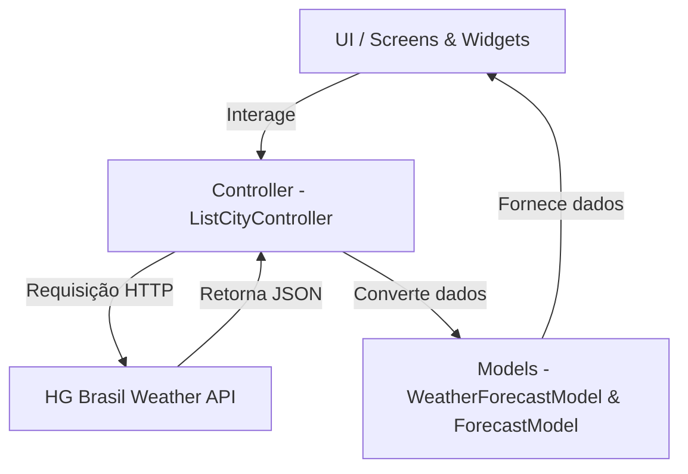

# 🌤️ Climapp

> Projeto para as aulas de Códigos de Alta Performance - Mobile (2026.2)

O **Climapp** é uma aplicação mobile desenvolvida em **Flutter** para consulta e acompanhamento de dados meteorológicos em tempo real, previsões diárias, fases da lua e detalhes climáticos de diferentes cidades.

---

## 👥 Integrantes

- **Victor Cesar Souza** — Matrícula: **16037431**
- **Kelvin Gabriel Oliveira Santana** — Matrícula: **16034918**

---

## ✅ Funcionalidades implementadas no checkpoint

Neste checkpoint foram implementadas e/ou ajustadas as seguintes funcionalidades:

- 🔔 Notificações push utilizando **Firebase Cloud Messaging (FCM)**.
- 📱 Exibição de notificações quando o aplicativo está em primeiro plano.
- 🌎 Exibição do país identificado/configurado no dispositivo.
- 📡 Tratamento amigável para situações em que o dispositivo está sem conexão com a internet.
- ⏱️ Timeout de **5 segundos** nas requisições à API.
- 🔄 Botão **"Tentar novamente"** após uma falha de conexão.
- 🏙️ Consulta das cidades solicitadas para o checkpoint:
  - Aracaju - SE
  - Itabaiana - SE
  - Salvador - BA
  - Curitiba - PR
- 🔎 Pesquisa e filtragem das cidades disponíveis.

---

## 🏗️ Arquitetura do Projeto

O projeto adota a arquitetura **MVC (Model-View-Controller)** combinada com o gerenciamento de estado do Flutter por meio de **`ChangeNotifier`** e **Provider**.



### Principais componentes

- **Models (`src/models/`)**: representam as estruturas dos dados climáticos e realizam a conversão dos dados recebidos da API.
- **Controllers (`src/controller/`)**: centralizam regras de negócio, requisições, filtragem e controle dos estados de carregamento e erro.
- **Views / Screens (`src/screens/`)**: representam as telas da aplicação e exibem os dados ao usuário.
- **Widgets (`src/widgets/`)**: componentes visuais reutilizáveis.
- **Services (`src/services/`)**: concentram serviços utilizados pela aplicação, como comunicação com a API, informações do dispositivo e notificações.

---

## 📡 Origem dos Dados

Os dados meteorológicos são obtidos através da **HG Brasil Weather API**.

- **Dados climáticos:** API de clima da HG Brasil.
- **Ícones de condição do tempo:** recursos disponibilizados pela HG Brasil.
- **Ícones de fases da lua:** recursos disponibilizados pela HG Brasil.

---

## 🔑 Configuração da API KEY

Por razões de segurança, a **API KEY da HG Brasil não fica diretamente armazenada no código-fonte**.

A chave é fornecida durante a execução do aplicativo utilizando `--dart-define` e é lida pela aplicação por meio de `String.fromEnvironment('API_KEY')`.

### Execução pelo terminal

Utilize:

```bash
flutter run -d emulator-5554 --dart-define=API_KEY=sua_chave_aqui
```

---

## 📁 Estrutura principal do projeto

```text
lib/
├── main.dart
└── src/
    ├── controller/
    │   └── list_city_controller.dart
    │
    ├── enums/
    │   └── enviroments_enum.dart
    │
    ├── models/
    │   ├── forecast_model.dart
    │   └── weather_forecast_model.dart
    │
    ├── screens/
    │   ├── list_city_screen.dart
    │   ├── weather_city_screen.dart
    │   └── welcome_screen.dart
    │
    ├── services/
    │   ├── device_info_service.dart
    │   ├── notification_service.dart
    │   └── weather_service.dart
    │
    └── widgets/
        └── city_tile_widget.dart
```

---

## 📄 Detalhamento dos principais arquivos

### 🚀 `lib/main.dart`

Ponto de entrada da aplicação.

É responsável por:

- inicializar o Flutter;
- inicializar o Firebase;
- configurar o Firebase Cloud Messaging;
- registrar o tratamento de mensagens recebidas em segundo plano;
- inicializar o serviço de notificações;
- configurar os Providers utilizados pela aplicação;
- iniciar a tela principal do aplicativo.

### ⚙️ `lib/src/enums/enviroments_enum.dart`

Centraliza as configurações relacionadas à API, incluindo a URL base e a leitura da variável `API_KEY` fornecida por `--dart-define`.

### 🎮 `lib/src/controller/list_city_controller.dart`

Controller responsável por:

- carregar os dados das cidades;
- armazenar a lista de cidades;
- armazenar a lista filtrada;
- realizar a filtragem de cidades;
- controlar o estado de carregamento;
- obter a identificação do país do dispositivo;
- armazenar e disponibilizar mensagens de erro;
- permitir uma nova tentativa de carregamento após uma falha.

### 🌤️ `lib/src/services/weather_service.dart`

Responsável pelas requisições à API meteorológica.

Também realiza:

- controle de timeout das requisições;
- tratamento de ausência de conexão com a internet;
- tratamento de respostas HTTP inválidas;
- conversão dos dados JSON recebidos para os modelos utilizados pela aplicação.

### 🔔 `lib/src/services/notification_service.dart`

Responsável pela configuração das notificações push utilizando **Firebase Cloud Messaging**.

Inclui:

- solicitação de permissão para notificações;
- obtenção do token FCM;
- atualização do token;
- tratamento de notificações recebidas em primeiro plano;
- tratamento de notificações abertas pelo usuário;
- tratamento de mensagens recebidas quando o aplicativo estava encerrado.

### 🌎 `lib/src/services/device_info_service.dart`

Responsável pela comunicação entre o Flutter e o código nativo do Android para obter informações relacionadas ao país do dispositivo.

### 🖥️ `lib/src/screens/welcome_screen.dart`

Tela inicial de boas-vindas do aplicativo.

Apresenta a identidade visual do Climapp e direciona o usuário para a tela de consulta das cidades.

### 🖥️ `lib/src/screens/list_city_screen.dart`

Tela principal de consulta das cidades.

Possui:

- campo de pesquisa;
- identificação do país;
- indicador de carregamento;
- lista de cidades;
- tela amigável para erros de conexão;
- botão para tentar novamente;
- acesso à tela de detalhes de cada cidade.

### 🖥️ `lib/src/screens/weather_city_screen.dart`

Tela de detalhes climáticos de uma cidade.

Exibe informações como:

- temperatura atual;
- condição climática;
- temperaturas mínima e máxima;
- umidade;
- informações de previsão;
- fases da lua.

### 🧩 `lib/src/widgets/city_tile_widget.dart`

Widget reutilizável responsável pela apresentação de cada cidade na lista, exibindo o nome, temperatura e ícone correspondente à condição climática.

---

## 🔔 Notificações Push

O aplicativo utiliza **Firebase Cloud Messaging (FCM)** para trabalhar com notificações push.

As mensagens recebidas enquanto o aplicativo está em primeiro plano são tratadas pelo aplicativo e apresentadas ao usuário por meio de uma mensagem visual na interface.

---

## 🌐 Tratamento de conexão e timeout

As requisições realizadas pela aplicação possuem um timeout de **5 segundos**.

Quando ocorre uma falha de conexão, a aplicação apresenta uma mensagem amigável informando que não foi possível carregar as cidades e disponibiliza o botão **"Tentar novamente"**.

Após o restabelecimento da conexão, o usuário pode realizar uma nova tentativa para carregar os dados.

---

## 🏙️ Cidades utilizadas no checkpoint

Para este checkpoint, foram configuradas as seguintes cidades:

| Cidade | Estado |
|---|---|
| Aracaju | SE |
| Itabaiana | SE |
| Salvador | BA |
| Curitiba | PR |

---

## 🛠️ Pacotes e Dependências Utilizadas

- **[http](https://pub.dev/packages/http)**: utilizado para realizar requisições HTTP à API.
- **[flutter_svg](https://pub.dev/packages/flutter_svg)**: utilizado para renderização de ícones SVG.
- **[google_fonts](https://pub.dev/packages/google_fonts)**: utilizado para aplicação da fonte Montserrat.
- **[flutter_map](https://pub.dev/packages/flutter_map)**: dependência relacionada a mapas.
- **[geolocator](https://pub.dev/packages/geolocator)**: dependência relacionada à localização geográfica.
- **[firebase_core](https://pub.dev/packages/firebase_core)**: inicialização e integração com Firebase.
- **[firebase_messaging](https://pub.dev/packages/firebase_messaging)**: integração com Firebase Cloud Messaging e notificações push.
- **[provider](https://pub.dev/packages/provider)**: gerenciamento de estado da aplicação.

---

## ▶️ Execução do projeto

Após clonar o repositório e instalar as dependências, execute:

```bash
flutter pub get
```

Depois, forneça a API KEY através de `--dart-define`:

```bash
flutter run -d emulator-5554 --dart-define=API_KEY=sua_chave_aqui
```

O aplicativo deve ser executado com um dispositivo ou emulador Android disponível.

---

## 📚 Tecnologias

- Flutter
- Dart
- Firebase
- Firebase Cloud Messaging
- Provider
- REST API
- HG Brasil Weather API
- Android